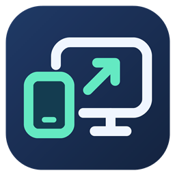

# 佳佳简易投屏

把安卓手机的画面投到安卓投影仪或电视上。两台设备安装同一个 APK，连同一个 Wi-Fi 即可使用，无需登录或开会员。

## 下载安装

从 [Releases](https://github.com/Alick4986/jiajia-cast/releases) 下载 APK，在手机和投影仪上分别安装。两台设备都需要 Android 8.0 或以上，投影仪需要允许安装 APK。

1. 手机和投影仪连接同一个家庭 Wi-Fi。
2. 投影仪打开应用，点「接收投屏」。
3. 手机或平板点「发送投屏」，选择设备、扫描接收端二维码，或输入接收端显示的 IP，再确认安卓的屏幕共享提示。
4. 结束时，点手机上的「结束投屏」，或按投影仪遥控器的返回键。

## 发送端设置

连接前可选择画质、帧率上限、音画缓冲和接收端显示方式。两端均使用 0.2.7 时，缓冲和显示设置会随连接发送。画面按原比例缩放，选择「铺满屏幕」时会居中裁切。调整后重新连接即可生效。

## 声音与兼容性

发送应用声音需要手机运行 Android 10 或以上，并允许系统提示中的「麦克风」权限。应用只采集允许共享的媒体声音，不采集麦克风的声音。拒绝这项权限或使用 Android 8、9 时，仍可投画面。部分视频应用会限制画面或声音共享，可以先用本地视频测试。

音视频在局域网内直传。当前没有传输加密或配对口令，请在可信的家庭网络使用。访客网络可能阻止设备互相发现。

如果遇到问题，请在 [Issues](https://github.com/Alick4986/jiajia-cast/issues) 附上手机和投影仪型号、Android 版本、应用版本，以及具体提示或复现步骤。

## 从源码构建

使用 JDK 17 和 Android SDK 34。在 Windows 上运行 `gradlew.bat assembleDebug`，在 macOS 或 Linux 上运行 `./gradlew assembleDebug`。生成的 APK 位于 `app/build/outputs/apk/debug/`。

## 许可证与致谢

H.264 编解码部分改自 [MirrorCast H264](https://github.com/jie-dle/mirrorcast-h264)，基于 [上游版本 d048b0b](https://github.com/jie-dle/mirrorcast-h264/commit/d048b0b713ca9af3e5b26289ac0cb63b12e3dbd7)。本项目调整了设备发现、连接方向、投屏流程和中文界面，并加入应用声音共享及新的启动图标。扫码使用 [ZXing Android Embedded](https://github.com/journeyapps/zxing-android-embedded)。许可证见 [Apache-2.0](LICENSE)。
